# Project 02: Infrastructure as Code with Terraform on Azure and AWS

## Goal
Build a small, repeatable Azure network with Terraform instead of clicking in the portal, then destroy it to keep cost near zero.

## What I built
- Resource group: `rg-tf-lab` (UAE North)
- Virtual network `vnet-tf-lab` (10.10.0.0/16)
- Subnet `snet-web` (10.10.1.0/24)
- Network security group `nsg-web` with an SSH rule, attached to the subnet
- Storage account with a random name (LRS)

## Tools
Terraform, Azure CLI, Azure, PowerShell, Git

## How to run it
1. `az login --tenant <your-tenant-id>`
2. Create `terraform.tfvars` with `subscription_id = "<your-id>"`
3. `terraform init`, `terraform validate`, `terraform plan`
4. `terraform apply`
5. `terraform destroy` when finished

## Screenshots
## Part 1: Azure screenshots

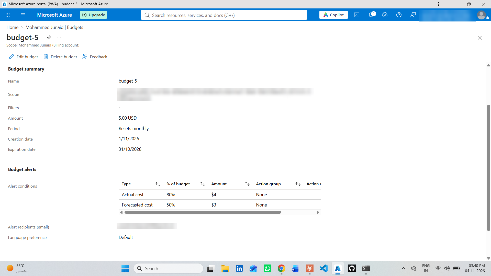

Terraform plan (7 resources to add):

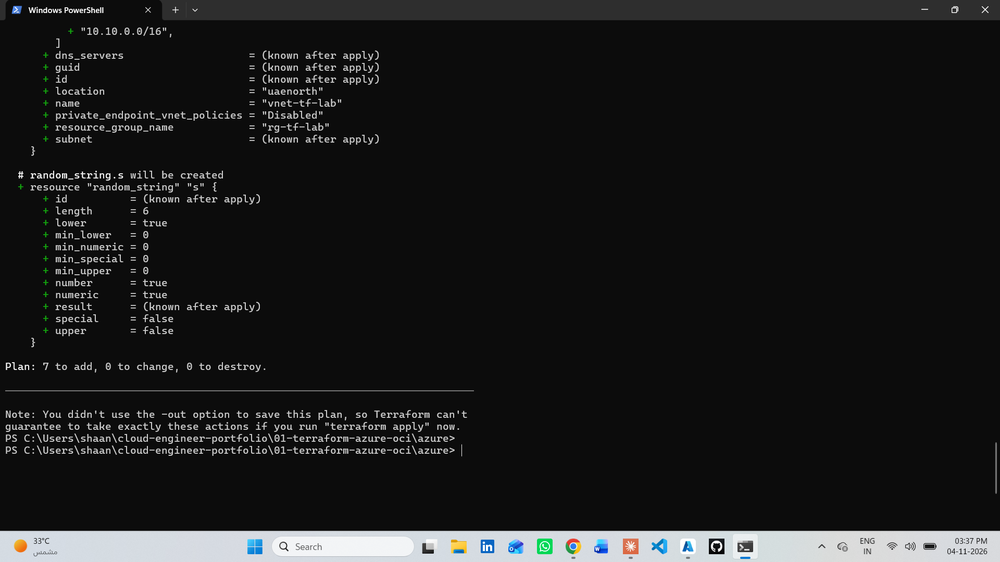

Terraform apply complete:

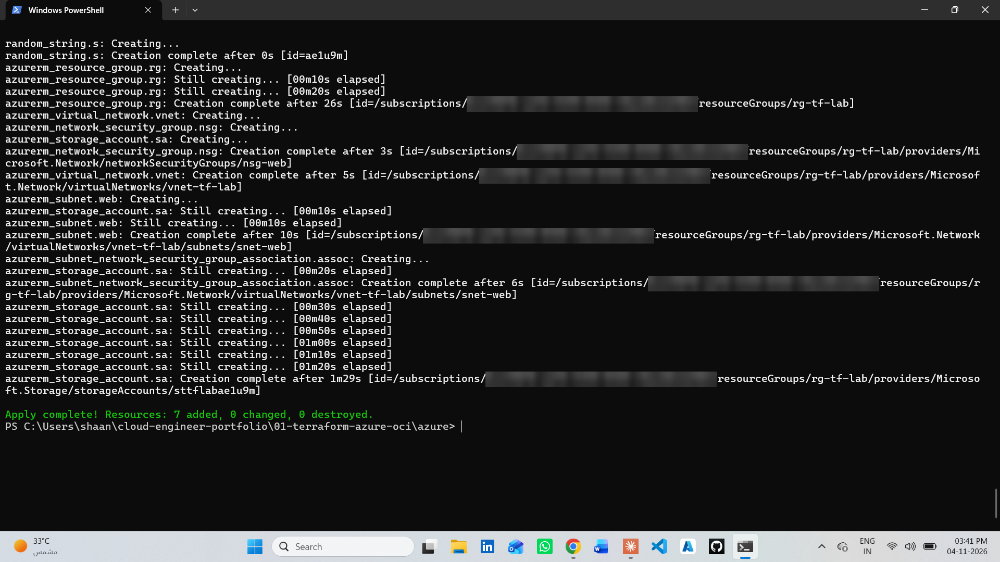

Resource group in the Azure portal:

Subnet attached to the NSG:

NSG rule:

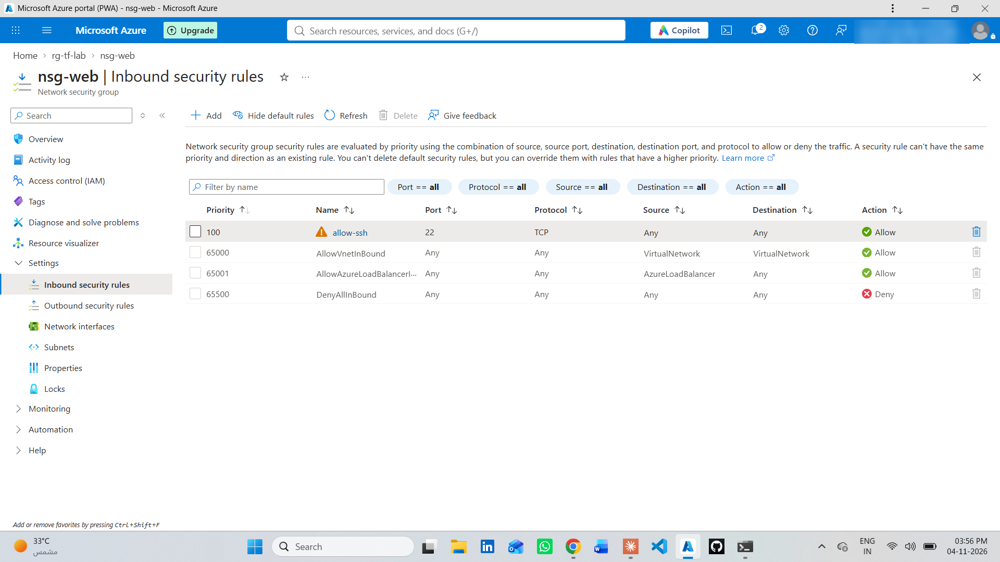

Destroy complete:

Resource groups after destroy (only my other lab remains):

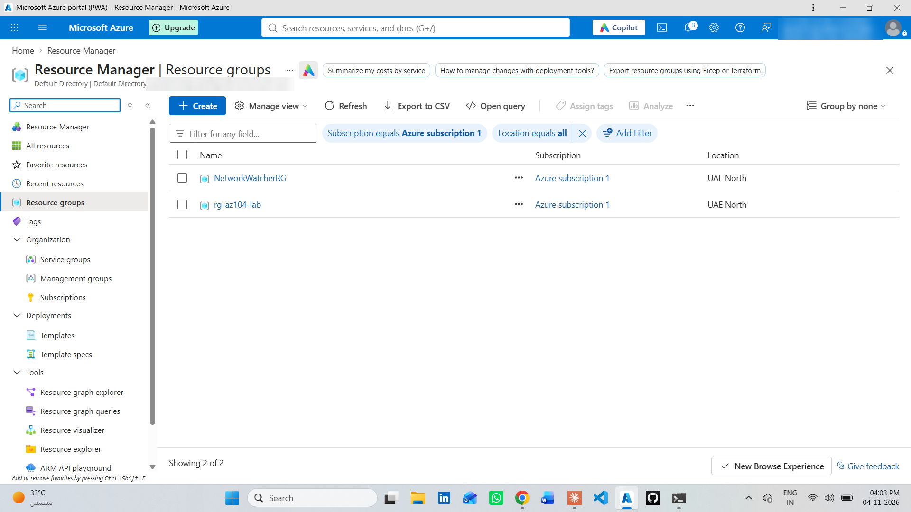

## Problems I hit and how I fixed them
- `az login` failed because my tenant needed multi-factor authentication. Fixed with `az login --tenant <tenant-id>`.
- `terraform plan` said "No configuration files" because my `main.tf` was not saved in the folder. I recreated the files and re-ran `init`.

## Security note
The SSH rule allows port 22 from any source. This is fine for a short lab, but in real use the source should be limited to a trusted IP range.

## Cost control
I set a budget alert, kept to free or very cheap resources, and ran `terraform destroy` after taking screenshots.

## What I learned
- How Terraform plans, applies and destroys infrastructure
- How state tracks what exists in Azure
- How to keep secrets (`*.tfvars`, state files) out of Git

## Next
Add the same network on AWS using Terraform.

Ctrl+End

## Part 2: The same network on AWS

I built the same idea on AWS in the Sydney region (ap-southeast-2). My free-plan account is fixed to that region, so I used it.

| Piece | Azure | AWS |
|---|---|---|
| Network | Virtual network (10.10.0.0/16) | VPC (10.20.0.0/16) |
| Subnet | Subnet (10.10.1.0/24) | Public subnet (10.20.1.0/24) |
| Firewall | Network security group, SSH rule | Security group, SSH only from my IP (/32) |
| Internet path | Built in | Internet gateway + route table + association |
| Storage | Storage account (LRS) | S3 bucket, public access blocked, encrypted |

### AWS result
- `terraform plan` showed 10 resources to add.
- `terraform apply` created all 10.
- I checked the VPC, the security group rule and the private S3 bucket in the console.
- `terraform destroy` removed all 10, so nothing is left running.

### AWS screenshots
Terraform plan:

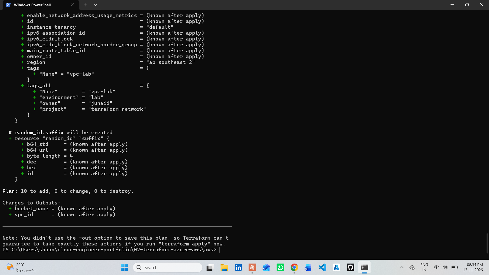

Terraform apply:

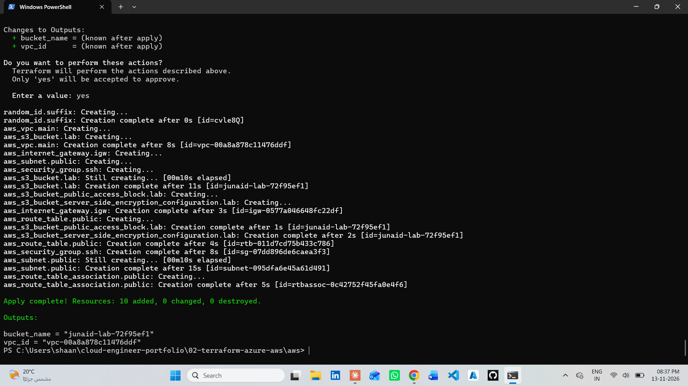

VPC in the console:

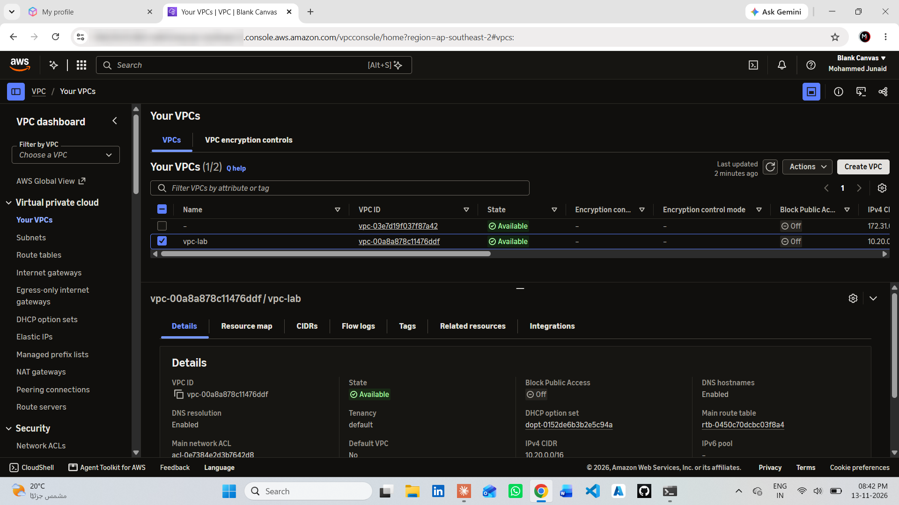

Security group, SSH from my IP only:

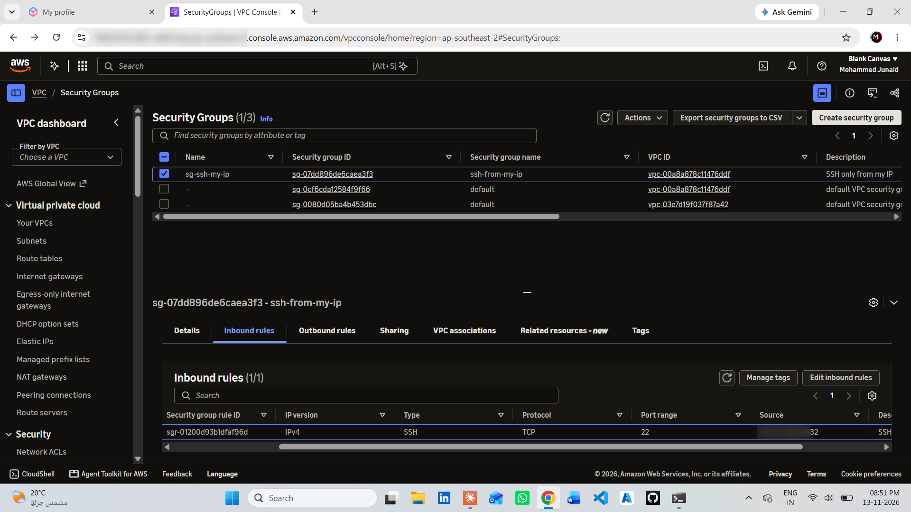

S3 bucket, block all public access on:

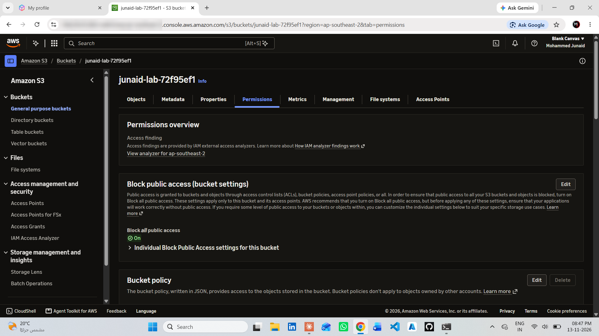

Destroy complete:

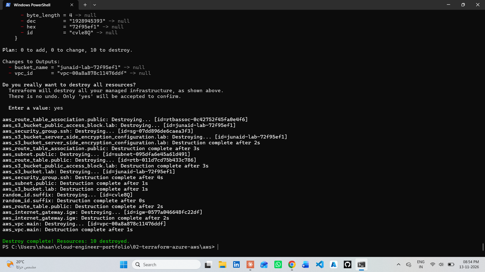

### Problems and fixes
- AWS refused a security group name starting with `sg-`. I renamed it `ssh-from-my-ip`.
- My free-plan account has no region selector, so I used Sydney instead of the UAE.
- I used `aws login` (browser sign-in) instead of long-lived access keys.

### What I learned
- The same design needs different building blocks on each cloud.
- SSH from one IP only (/32) is a simple, strong default.
- Block public access on S3 from day one.
