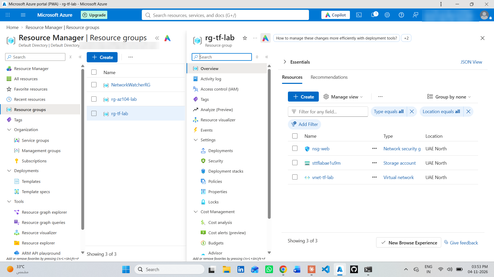
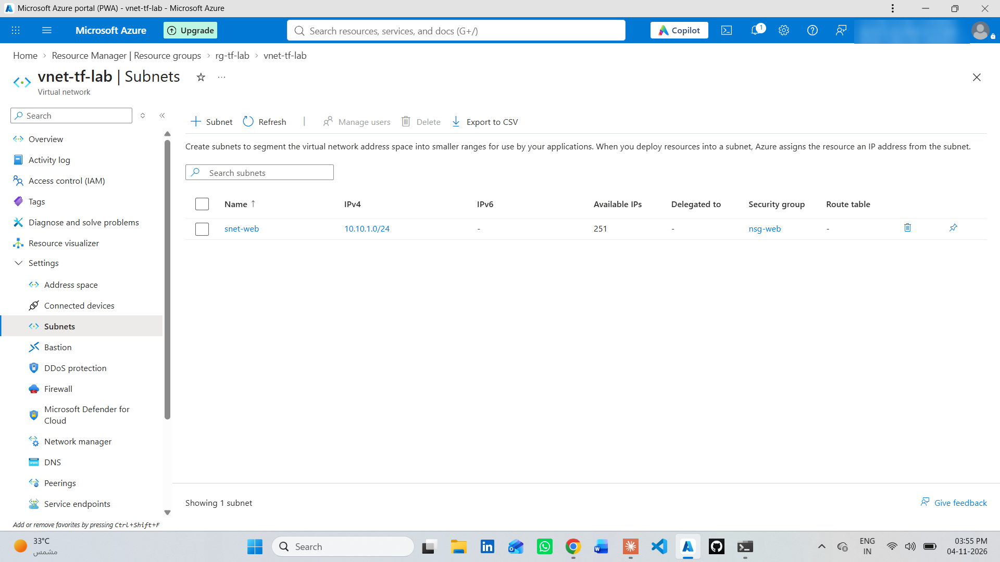
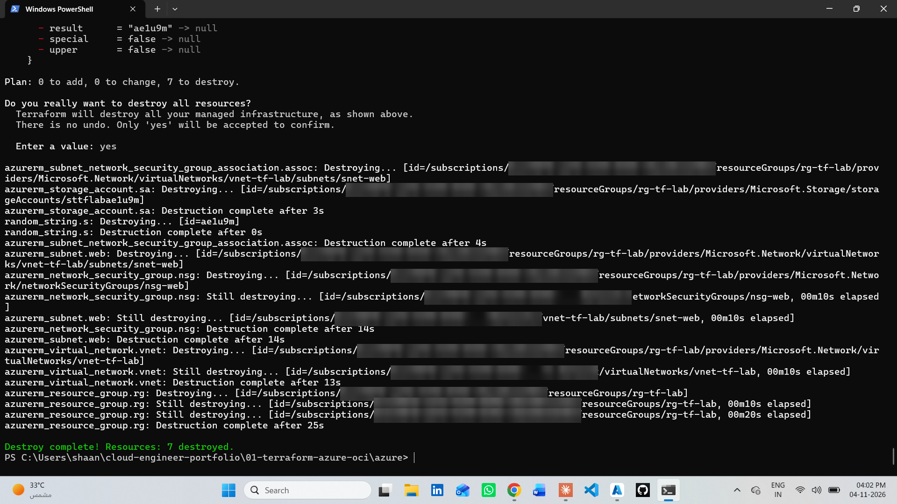

# Project 02: Infrastructure as Code with Terraform on Azure

## Goal
Build a small, repeatable Azure network with Terraform instead of clicking in the portal, then destroy it to keep cost near zero.

## What I built
- Resource group: `rg-tf-lab` (UAE North)
- Virtual network `vnet-tf-lab` (10.10.0.0/16)
- Subnet `snet-web` (10.10.1.0/24)
- Network security group `nsg-web` with an SSH rule, attached to the subnet
- Storage account with a random name (LRS)

## Tools
Terraform, Azure CLI, Azure, PowerShell, Git

## How to run it
1. `az login --tenant <your-tenant-id>`
2. Create `terraform.tfvars` with `subscription_id = "<your-id>"`
3. `terraform init`, `terraform validate`, `terraform plan`
4. `terraform apply`
5. `terraform destroy` when finished

## Screenshots
Budget alert (set before deploying):

Terraform plan (7 resources to add):

Terraform apply complete:

Resource group in the Azure portal:

Subnet attached to the NSG:

NSG rule:

Destroy complete:

Resource groups after destroy (only my other lab remains):

## Problems I hit and how I fixed them
- `az login` failed because my tenant needed multi-factor authentication. Fixed with `az login --tenant <tenant-id>`.
- `terraform plan` said "No configuration files" because my `main.tf` was not saved in the folder. I recreated the files and re-ran `init`.

## Security note
The SSH rule allows port 22 from any source. This is fine for a short lab, but in real use the source should be limited to a trusted IP range.

## Cost control
I set a budget alert, kept to free or very cheap resources, and ran `terraform destroy` after taking screenshots.

## What I learned
- How Terraform plans, applies and destroys infrastructure
- How state tracks what exists in Azure
- How to keep secrets (`*.tfvars`, state files) out of Git

## Next
Add the same network on AWS using Terraform.

