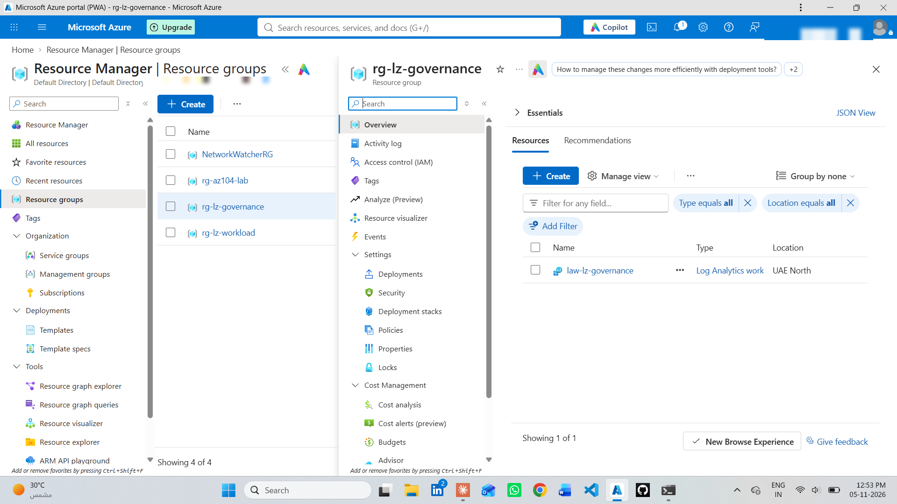
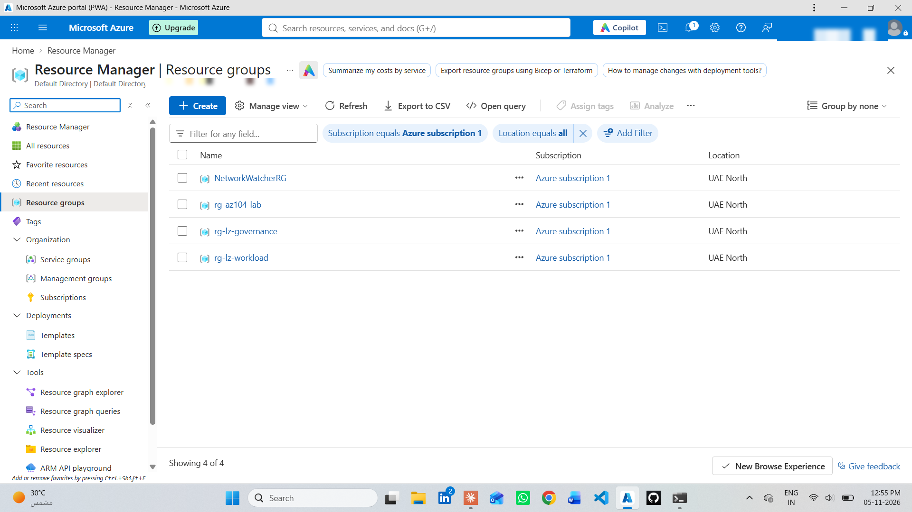
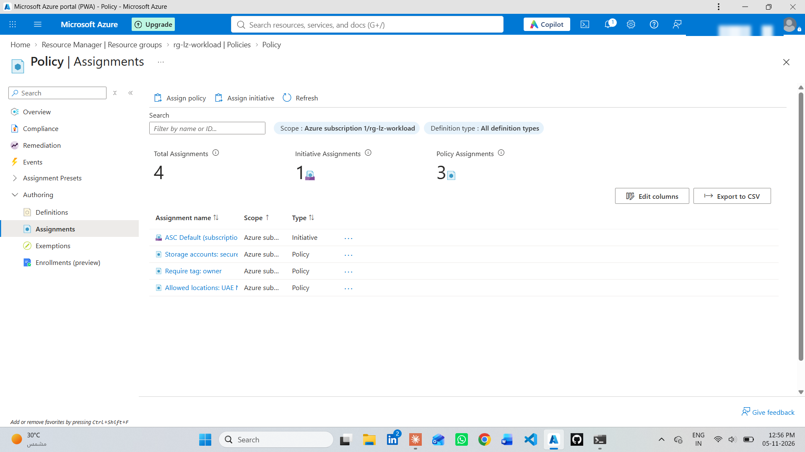
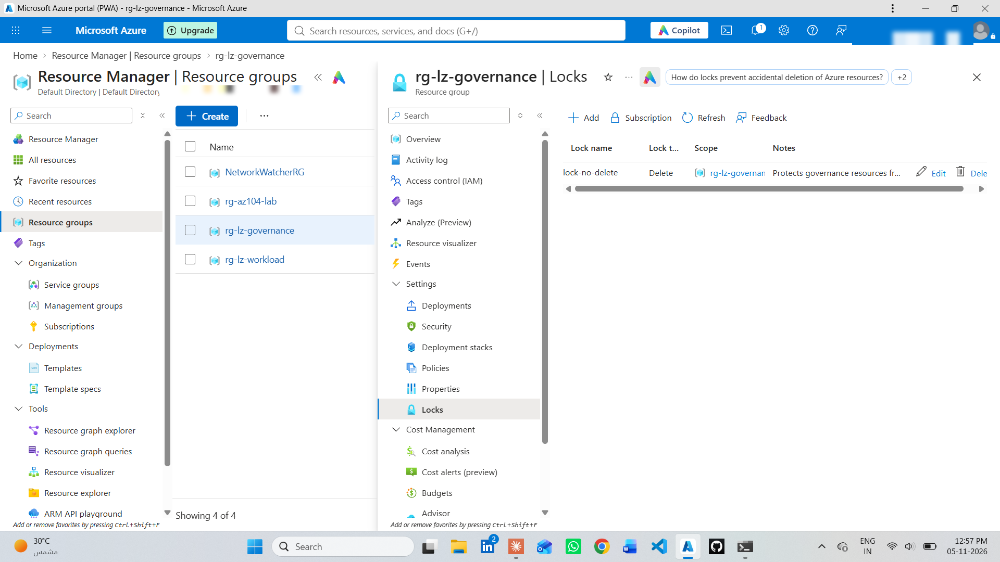
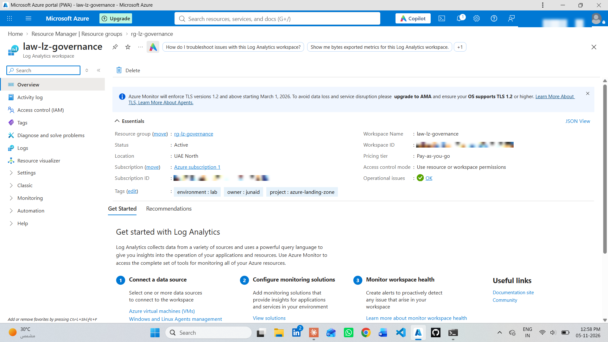
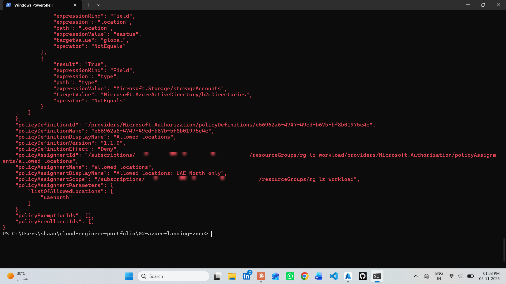
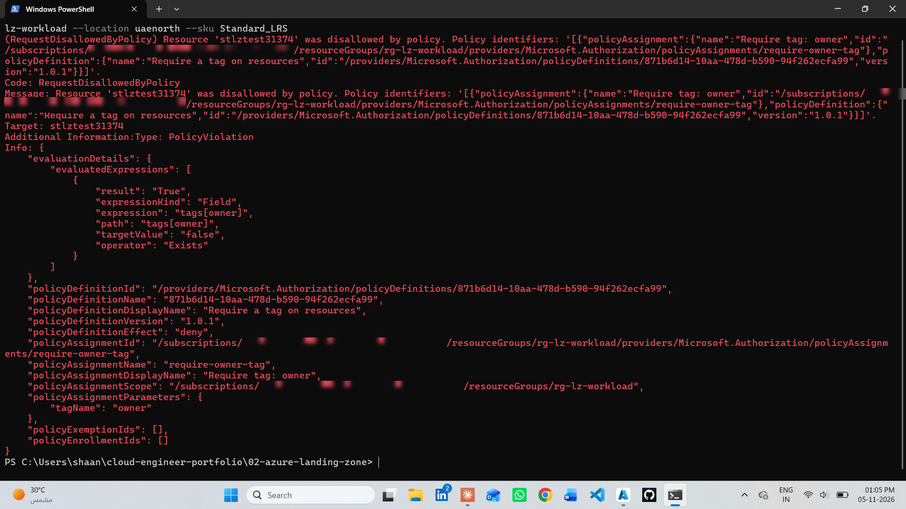
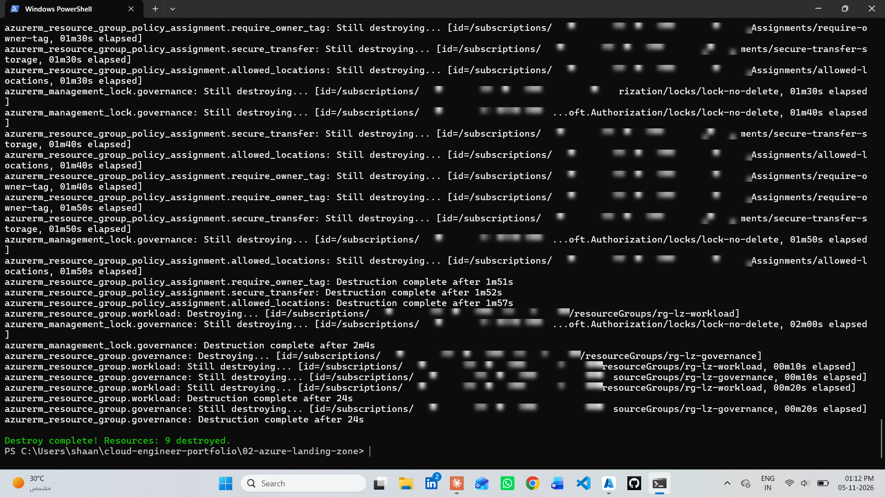
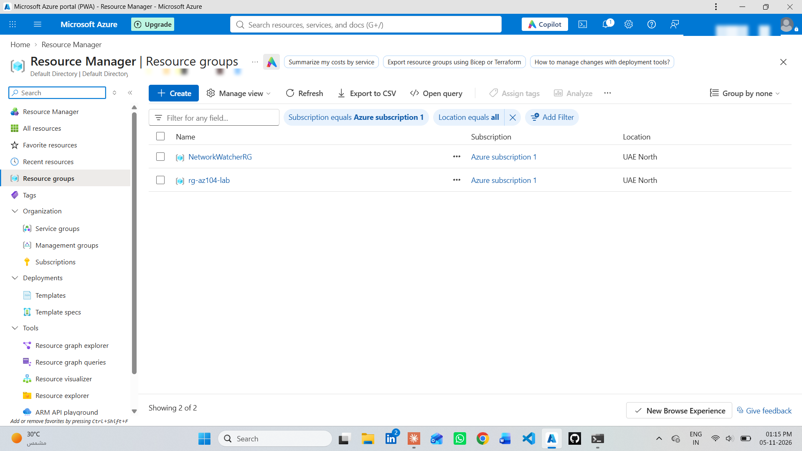

# Project 03 - Azure Landing Zone with Terraform

A small landing zone on Azure, built entirely with Terraform. It adds governance guardrails (policy, locks, logging, budget) so resources follow the rules from day one. Region: **UAE North**, the closest Azure region to Saudi Arabia.

## What I built

| Resource | Purpose |
|---|---|
| 2 resource groups (`rg-lz-governance`, `rg-lz-workload`) | Separate governance tools from workloads |
| 3 Azure Policy assignments on the workload group | Allowed locations (UAE North only), require `owner` tag, secure transfer for storage |
| Delete lock on the governance group | Stops accidental deletion |
| Log Analytics workspace + activity log diagnostic setting | Central audit log for the subscription |
| $5 budget with an 80% alert | Cost control |

Total: **9 resources**, created with one `terraform apply` and removed with one `terraform destroy`.

## How to run

```powershell
az login --tenant <your-tenant-id>
cd 02-azure-landing-zone
# create terraform.tfvars with subscription_id and alert_email (it is gitignored)
terraform init
terraform plan
terraform apply
```

## Screenshots

**1. Resource groups and Log Analytics workspace**



**2. Resource groups list**



**3. Policy assignments on the workload group**



**4. Delete lock on the governance group**



**5. Log Analytics workspace**



## Policy test: the guardrails work

I tried to break the rules on purpose. Both attempts were denied.

**Test A - storage account in a region that is not allowed (East US)** was denied by the `Allowed locations: UAE North only` policy.



**Test B - storage account in UAE North without the `owner` tag** was denied by the `Require tag: owner` policy.



## Clean up

`terraform destroy` removed all 9 resources, including the lock.





## Alignment with Saudi NCA ECC (indicative, domain level)

This is a simple mapping to show the thinking. It is not a compliance claim.

| What I built | Related ECC area |
|---|---|
| Allowed locations policy (UAE North only) | Cloud computing and data location / data residency |
| Required `owner` tag | Asset management and ownership |
| Secure transfer (HTTPS) for storage | Cryptography / protection of data in transit |
| Delete lock on governance group | Change and configuration protection |
| Activity log to Log Analytics | Event logs and monitoring |
| Budget alert | Operations / cost governance (not an ECC control) |

## Problems and fixes

- **West Europe test was blocked by Azure itself**, not by my policy (the subscription cannot create resources there). I retested with East US to prove my policy works.
- **Policy takes time to start.** New policy assignments can take 5 to 15 minutes to enforce, so I waited before testing.
- **Destroy order.** The lock must be removed before its resource group. Terraform handles this automatically.

## What I learned

- Policy with the Deny effect stops bad resources before they are created.
- Locks, tags and budgets are cheap and show good cloud governance habits.
- Terraform makes the whole landing zone repeatable and easy to remove.

## Cost

Nothing was left running. Everything was destroyed after testing.

